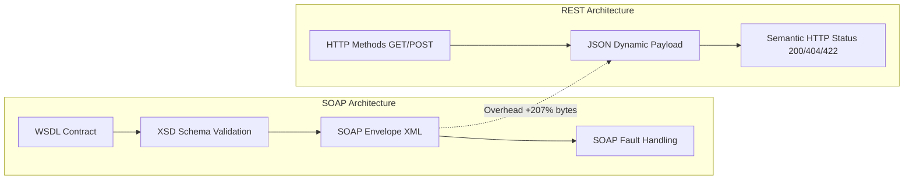

# Border Control: 1999 vs. 2026 (Workstation Edition)

Aplicação web acadêmica e gamificada no estilo *Papers, Please*, desenvolvida para integrar, instrumentar e comparar em tempo de execução real **APIs REST públicas (JSON)** e um **Web Service SOAP público (XML baseado em WSDL)** em uma arquitetura coesa de sistemas distribuídos.

---

## 1. Documentações Oficiais e Contratos WSDL

| Serviço / Protocolo | Papel na Aplicação | Documentação Oficial | Endpoint de Produção / Link Direto WSDL | Backup Local no Repositório |
| :--- | :--- | :--- | :--- | :--- |
| **CountryInfoService (SOAP 1.1 / XML)** | **Mainframe Governamental (1999):** Fonte canônica de dados internacionais (Capital, Moeda, Código DDI, Continente). | [Oorsprong CountryInfo Docs](http://webservices.oorsprong.org/websamples.countryinfo/CountryInfoService.wso) | [http://webservices.oorsprong.org/websamples.countryinfo/CountryInfoService.wso?WSDL](http://webservices.oorsprong.org/websamples.countryinfo/CountryInfoService.wso?WSDL) | [`contracts/CountryInfoService.wsdl`](./contracts/CountryInfoService.wsdl) |
| **Countries API (Cloudflare / REST JSON)** | **Terminal do Viajante (2026):** Dados dinâmicos de países, capitais, bandeiras e códigos de discagem. | [Cloudflare Countries API](https://countries-api.davegarvey.workers.dev/countries) | `https://countries-api.davegarvey.workers.dev/countries/{code}` | N/A (JSON Schema Dinâmico) |
| **RandomUser Generator API (REST JSON)** | **Identidade Cultural Dinâmica (2026):** Gera nomes reais e datas de nascimento nativas de acordo com a nacionalidade (`?nat={iso}`) do viajante. | [RandomUser.me Documentation](https://randomuser.me/documentation) | `https://randomuser.me/api/?nat={code}&inc=name,dob,nat` | N/A (JSON Schema Dinâmico) |
| **Daily Wanted Bulletin (REST JSON)** | **Registro de Segurança (2026):** Boletim diário dos 3 fugitivos procurados no turno. | Módulo Nativo REST | `/api/inspections/shift/current` | N/A (REST JSON Endpoint) |

---

## 2. Mecânica da Cabine e Integração entre Protocolos

O jogador atua como oficial de alfândega em uma cabine de fronteira com 3 áreas físicas interativas:

1. **Vidro da Cabine (Superior Esquerdo):** O viajante se aproxima caminhando. O oficial solicita os documentos (`"Papers, Please"`) e interroga o passageiro em um chat com histórico e indicador de digitação.
2. **Monitor CRT 1999 + Impressora Matricial (Superior Direito):**
   * **`MAINFRAME.EXE` (Cliente SOAP 1.1 WSDL):** O oficial lê o código ISO no passaporte e digita no terminal CRT. A aplicação envia um **Envelope XML SOAP** ao `CountryInfoService`, decodifica a resposta e imprime os dados canônicos em papel contínuo na mesa.
   * **`WANTED_LIST.EXE` (Cliente REST JSON):** Spooler que imprime na mesa a lista com foto e nome dos **3 Procurados do Dia**.
3. **Mesa Metálica de Inspeção (Inferior):** Espaço físico com arraste via Pointer Events, livro de regras A4 com capa dura vermelha e páginas viráveis, passaporte eletrônico (com retrato DiceBear, holograma e MRZ), manifesto monetário, estação de carimbos (`ADMIT` / `DETAIN` com justificativa pericial) e lixeira externa à esquerda.

---

## 3. Evidências Reais de Payloads Brutos Capturados

### 3.1. SOAP: Envelope XML Enviado (Request)
* **Código-fonte responsável:** [`app/adapters/soap_adapter.py`](./app/adapters/soap_adapter.py) (usando `zeep` + `HistoryPlugin`)
* **Endpoint:** `http://webservices.oorsprong.org/websamples.countryinfo/CountryInfoService.wso`
* **Operação:** `FullCountryInfo`
* **Tamanho do Payload:** 288 bytes

```xml
<?xml version="1.0" encoding="utf-8"?>
<soap:Envelope xmlns:soap="http://schemas.xmlsoap.org/soap/envelope/">
  <soap:Body>
    <FullCountryInfo xmlns="http://www.oorsprong.org/websamples.countryinfo">
      <sCountryISOCode>JP</sCountryISOCode>
    </FullCountryInfo>
  </soap:Body>
</soap:Envelope>
```

### 3.2. SOAP: Bloco XML Recebido (Response)
* **Status HTTP:** `200 OK`
* **Content-Type:** `text/xml; charset=utf-8`
* **Tamanho do Payload:** 762 bytes

```xml
<?xml version="1.0" encoding="utf-8"?>
<soap:Envelope xmlns:soap="http://schemas.xmlsoap.org/soap/envelope/">
  <soap:Body>
    <m:FullCountryInfoResponse xmlns:m="http://www.oorsprong.org/websamples.countryinfo">
      <m:FullCountryInfoResult>
        <m:sISOCode>JP</m:sISOCode>
        <m:sName>Japan</m:sName>
        <m:sCapitalCity>Tokyo</m:sCapitalCity>
        <m:sPhoneCode>81</m:sPhoneCode>
        <m:sContinentCode>AS</m:sContinentCode>
        <m:sCurrencyISOCode>JPY</m:sCurrencyISOCode>
        <m:sCountryFlag>http://www.oorsprong.org/WebSamples.CountryInfo/Flags/Japan.jpg</m:sCountryFlag>
        <m:Languages>
          <m:tLanguage>
            <m:sISOCode>jpn</m:sISOCode>
            <m:sName>Japanese</m:sName>
          </m:tLanguage>
        </m:Languages>
      </m:FullCountryInfoResult>
    </m:FullCountryInfoResponse>
  </soap:Body>
</soap:Envelope>
```

### 3.3. REST: Texto JSON Recebido (Countries API + RandomUser API)
* **Código-fonte responsável:** [`app/adapters/rest_adapter.py`](./app/adapters/rest_adapter.py) e [`app/adapters/random_user_adapter.py`](./app/adapters/random_user_adapter.py) (usando `httpx.AsyncClient`)

**Exemplo 1 — Countries API (`GET https://countries-api.davegarvey.workers.dev/countries/JP` — 248 bytes):**
```json
{
  "name": "Japan",
  "code": "JP",
  "alpha3Code": "JPN",
  "capital": "Tokyo",
  "region": "Asia",
  "subregion": "Eastern Asia",
  "population": 126476461,
  "languages": [
    "Japanese"
  ],
  "currency": "JPY",
  "flag": "🇯🇵",
  "callingCode": "+81"
}
```

**Exemplo 2 — RandomUser API (`GET https://randomuser.me/api/?nat=BR&inc=name,dob,nat` — 214 bytes):**
```json
{
  "results": [
    {
      "name": {
        "title": "Ms",
        "first": "Violeta",
        "last": "da Costa"
      },
      "dob": {
        "date": "1967-04-23T12:48:32.781Z",
        "age": 59
      },
      "nat": "BR"
    }
  ],
  "info": {
    "seed": "11a37947031662d5",
    "results": 1,
    "page": 1,
    "version": "1.4"
  }
}
```

---

## 4. Análise Técnica Comparativa: REST vs. SOAP



* **Overhead de Payload:** O SOAP encapsula os dados em `<soap:Envelope>`, `<soap:Body>`, namespaces XML e tags repetitivas de abertura e fechamento (**762 bytes**), resultando em **+207% de overhead** frente aos **248 bytes** do JSON equivalente da Countries API.
* **Tipagem e Contrato:** O contrato `CountryInfoService.wsdl` impõe validação rígida por XML Schema (`xs:string`, `tCountryInfo`) antes do envio via `Zeep`, enquanto as APIs REST oferecem esquema dinâmico em JSON validado no backend via Pydantic.
* **Tratamento de Erros:** Falhas no SOAP retornam `<soap:Fault>` (`<faultcode>`, `<faultstring>`, `<detail>`) dentro do corpo XML (geralmente com HTTP 500/400), exigindo parsing XML pelo cliente. No REST, o status semântico HTTP (`404 Not Found`, `422 Unprocessable Content`) identifica o erro diretamente no cabeçalho.

---

## 5. Dificuldades Encontradas e Observações Importantes do Trabalho

Durante o desenvolvimento e integração em ambiente real, enfrentamos desafios práticos relevantes sobre sistemas distribuídos:

1. **Descontinuação Repentina de API Pública REST:** Inicialmente o projeto consumia a `restcountries.com/v3.1`, que passou a retornar `HTTP 301` com aviso de deprecação exigindo chave paga na v5. Graças ao **Adapter Pattern** isolado no projeto, foi possível migrar para a `countries-api.davegarvey.workers.dev` alterando apenas `RestCountriesAdapter` sem impactar o motor de regras.
2. **Disponibilidade e Latência de Serviços SOAP Legados:** Serviços SOAP públicos antigos (como servidores do BCB e `dataaccess.com`) apresentaram falhas de proxy reverso (502) e handshake TLS. Para garantir resiliência durante apresentações ao vivo, implementamos **cópia local de backup do contrato** em `contracts/CountryInfoService.wsdl` com fallback automático caso o WSDL remoto sofra timeout.
3. **Limitação Regional de APIs de Identidade:** A `randomuser.me` suporta nativamente 21 nacionalidades (`nat`); para os demais países da lista de 30 nações (como Japão, Itália e Argentina), implementamos um fallback cultural regional para manter a coerência entre nome e país de origem.
4. **Captura Real do XML Trafegado:** Bibliotecas SOAP de alto nível abstraem o XML por padrão. Foi necessário acoplar o `HistoryPlugin` do `Zeep` com `lxml.etree` para interceptar os buffers exatos enviados e recebidos na rede sem alterar a chamada de negócio.

---

## 6. Arquitetura do Projeto

```text
border-control-rest-soap/
├── app/
│   ├── main.py                         # Inicialização FastAPI, middleware no-cache e StaticFiles
│   ├── domain/models.py                # Modelos de domínio (CountryRecord, Passport, Telemetry)
│   ├── adapters/
│   │   ├── rest_adapter.py             # Cliente REST Countries API (HTTPX)
│   │   ├── random_user_adapter.py      # Cliente REST RandomUser.me API (HTTPX)
│   │   └── soap_adapter.py             # Cliente SOAP WSDL (Zeep + HistoryPlugin)
│   ├── game/
│   │   ├── strategies.py               # Strategy Pattern: 8 tipos de fraudes e anomalias
│   │   ├── repository.py               # Repository Pattern em memória
│   │   └── service.py                  # Motor de turnos (6-10 passageiros) e orquestração
│   └── api/routes.py                   # Endpoints REST da aplicação
├── contracts/CountryInfoService.wsdl   # Backup local oficial do contrato WSDL
├── static/
│   ├── index.html                      # Interface 3-Screen Workstation
│   ├── css/                            # Estilos procedurais (CRT 3D, papel A4, impressora)
│   └── js/                             # Arraste Pointer Events, MRZ, Web Audio API e Alpine.js
└── tests/                              # Suíte Pytest (WSDL, Adaptadores, Motor e Endpoints)
```

---

## 7. Instalação, Execução e Passo a Passo para Testar

### 7.1. Instalação Local

```bash
git clone https://github.com/Tefo02/border-control-rest-soap.git
cd border-control-rest-soap

python3 -m venv .venv
source .venv/bin/activate
pip install -r requirements.txt
```

*(No Windows PowerShell, ative o ambiente virtual com `.venv\Scripts\Activate.ps1`).*

### 7.2. Executar Testes Automatizados (REST, SOAP, WSDL e Motor de Regras)

```bash
pytest
```
Todos os **17 testes** devem passar (`17 passed`), validando o parsing do WSDL local/remoto, chamadas reais REST (`Countries API` e `RandomUser.me`), chamadas reais SOAP (`FullCountryInfo`), estratégias de fraude e ciclo completo dos endpoints FastAPI.

### 7.3. Executar a Aplicação Web

```bash
uvicorn app.main:app --reload --port 8000
```
Acesse no navegador: **[http://localhost:8000](http://localhost:8000)**

### 7.4. Roteiro Passo a Passo para Testar na Apresentação

1. **Receber o Viajante e Solicitar Documentos:**
   * Aguarde o passageiro entrar caminhando no guichê (canto superior esquerdo).
   * Clique em **`"PAPERS, PLEASE" — REQUEST DOCUMENTS`** (ou pressione `Espaço`). O Passaporte e o Manifesto deslizam sequencialmente para a mesa metálica.
2. **Interrogar e Inspecionar Documentos:**
   * Arraste os documentos livremente pela mesa. Use o **Livro de Regras** vermelho à esquerda (abra e folheie as 3 páginas) para conferir a data do turno (`2026-11-16`).
   * Use os botões `Ask Origin/DDI`, `Ask Currency` e `Ask Purpose` para checar contradições no histórico do chat.
3. **Consultar o Web Service SOAP no Monitor CRT:**
   * No monitor bege `IBM 8514/A` (canto superior direito), digite o código ISO do passaporte (ex: `JP`, `BR`, `DE`) no prompt `>` e pressione `Enter`.
   * Observe a discagem no terminal e a **Impressora Matricial (`EPSON FX-80`)** imprimindo progressivamente o recibo oficial WSDL de baixo para cima na mesa.
4. **Imprimir a Lista de Procurados (REST):**
   * Alterne para a aba `WANTED_LIST.EXE [REST]` no monitor e clique em **`PRINT DAILY WANTED LIST`** para imprimir o boletim com os 3 procurados do dia.
5. **Carimbar, Devolver e Limpar a Mesa:**
   * Arraste o Passaporte para a direita (`STAMPING STATION`) e clique em **`ADMIT`** ou **`DETAIN`** (escolhendo o motivo exato para ganhar +150 PTS).
   * Arraste o Passaporte carimbado e o Manifesto para cima, dentro da **Janela do Passageiro**, para devolvê-los e encerrar o atendimento.
   * Recibos impressos antigos podem ser arrastados para fora da borda esquerda da mesa até a lixeira **`FLOOR TRASH`**.
6. **Auditar Métricas e Payloads Brutos (Modo Apresentação Técnica):**
   * Clique no botão **`DEV / AUDIT CONSOLE`** no canto superior direito para revelar em tempo real a latência (ms), tamanho em bytes, overhead do XML e as abas com o **XML SOAP bruto**, o **JSON REST bruto** e o simulador **`SIMULATE SOAP FAULT vs REST 404`**.
