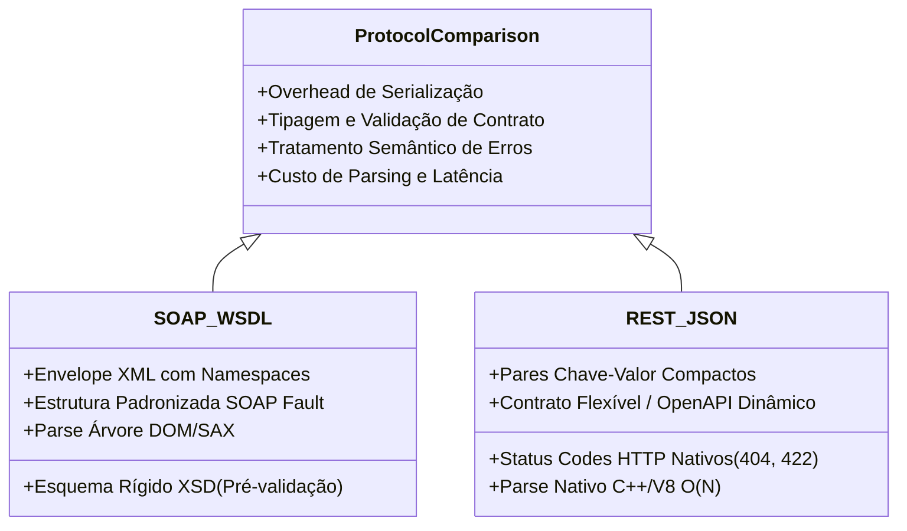

# Border Control: 1999 vs. 2026 (Web Services Inspector)

Aplicação web acadêmica e gamificada no estilo *Papers, Please*, desenvolvida para integrar, instrumentar e comparar em tempo de execução real uma **API REST pública (JSON)** e um **Web Service SOAP público (XML baseado em WSDL)** em uma arquitetura de sistemas distribuídos.

---

## 1. Documentações Oficiais e Contratos WSDL

| Serviço / Protocolo | Papel na Aplicação | Documentação Oficial | Endpoint de Produção / WSDL | Backup Local no Repositório |
| :--- | :--- | :--- | :--- | :--- |
| **CountryInfoService (SOAP 1.1 / XML)** | **Mainframe Governamental (1999):** Fonte canônica e imutável de dados internacionais (Capital, Moeda, Código DDI, Continente). | [Oorsprong CountryInfo Docs](http://webservices.oorsprong.org/websamples.countryinfo/CountryInfoService.wso) | [CountryInfoService.wso?WSDL](http://webservices.oorsprong.org/websamples.countryinfo/CountryInfoService.wso?WSDL) | [`contracts/CountryInfoService.wsdl`](./contracts/CountryInfoService.wsdl) |
| **REST Countries v3.1 (RESTful / JSON)** | **Terminal do Viajante (2026):** Passaporte eletrônico dinâmico com biometria, nomes, bandeiras e moeda declarada. | [REST Countries Documentation](https://gitlab.com/restcountries/restcountries) | `https://restcountries.com/v3.1/alpha/{code}` | N/A (JSON Schema Dinâmico) |

---

## 2. Metáfora de Domínio e Mecânica da Aplicação

A aplicação coloca o usuário no papel de um **Oficial de Alfândega e Fronteira Digital**. A cada rodada:

1. **Terminal 2026 (REST / JSON):** Apresenta o passaporte digital emitido contemporaneamente, contendo os dados declarados pelo viajante (País, Capital alegada, Moeda na carteira e Código DDI).
2. **Mainframe 1999 (SOAP / XML):** Um terminal retrô estilo CRT em fósforo verde permite consultar o banco de dados oficial via envelope SOAP 1.1 WSDL.
3. **Mecânica de Fraude e Julgamento:**
   * O motor de regras possui **45% de probabilidade** de injetar inconsistências deliberadas no passaporte do viajante (capital adulterada, moeda estrangeira incompatível, código DDI falso ou código ISO inexistente).
   * O oficial inspeciona os dados canônicos retornados pelo WSDL do mainframe e carimba **`[APPROVE ENTRY]`** ou **`[DENY ENTRY]`**.
   * Ao carimbar, a aplicação valida a decisão contra o gabarito no backend, calcula a pontuação (+100 acerto / -50 infração) e emite uma explicação técnica detalhada do veredito.
4. **Painel de Telemetria:** Expõe em tempo real o comparativo numérico de **latência (ms)**, **tamanho de payload (bytes)**, **taxa de overhead de serialização XML vs JSON** e um visualizador com syntax highlighting dos **payloads brutos trafegados na rede**.

---

## 3. Evidências Reais de Payloads Brutos Capturados

### 3.1. SOAP: Envelope XML Enviado (Request)
* **Protocolo:** SOAP 1.1 over HTTP/1.1 (POST)
* **Endpoint:** `http://webservices.oorsprong.org/websamples.countryinfo/CountryInfoService.wso`
* **Operação:** `FullCountryInfo`
* **Tamanho do Payload:** 288 bytes

```xml
<?xml version="1.0" encoding="utf-8"?>
<soap:Envelope xmlns:soap="http://schemas.xmlsoap.org/soap/envelope/">
  <soap:Body>
    <FullCountryInfo xmlns="http://www.oorsprong.org/websamples.countryinfo">
      <sCountryISOCode>BR</sCountryISOCode>
    </FullCountryInfo>
  </soap:Body>
</soap:Envelope>
```

### 3.2. SOAP: Envelope XML Recebido (Response)
* **Status HTTP:** `200 OK`
* **Content-Type:** `text/xml; charset=utf-8`
* **Tamanho do Payload:** 774 bytes

```xml
<?xml version="1.0" encoding="utf-8"?>
<soap:Envelope xmlns:soap="http://schemas.xmlsoap.org/soap/envelope/">
  <soap:Body>
    <m:FullCountryInfoResponse xmlns:m="http://www.oorsprong.org/websamples.countryinfo">
      <m:FullCountryInfoResult>
        <m:sISOCode>BR</m:sISOCode>
        <m:sName>Brazil</m:sName>
        <m:sCapitalCity>Brasilia</m:sCapitalCity>
        <m:sPhoneCode>55</m:sPhoneCode>
        <m:sContinentCode>AM</m:sContinentCode>
        <m:sCurrencyISOCode>BRL</m:sCurrencyISOCode>
        <m:sCountryFlag>http://www.oorsprong.org/WebSamples.CountryInfo/Flags/Brazil.jpg</m:sCountryFlag>
        <m:Languages>
          <m:tLanguage>
            <m:sISOCode>por</m:sISOCode>
            <m:sName>Portuguese</m:sName>
          </m:tLanguage>
        </m:Languages>
      </m:FullCountryInfoResult>
    </m:FullCountryInfoResponse>
  </soap:Body>
</soap:Envelope>
```

### 3.3. REST: Documento JSON Recebido (Response)
* **Protocolo:** HTTP/1.1 / HTTP/2 (GET)
* **Endpoint:** `https://restcountries.com/v3.1/alpha/BR?fields=name,capital,currencies,idd,cca2,region,flags`
* **Status HTTP:** `200 OK`
* **Content-Type:** `application/json; charset=utf-8`
* **Tamanho do Payload:** 512 bytes

```json
{
  "flags": {
    "png": "https://flagcdn.com/w320/br.png",
    "svg": "https://flagcdn.com/br.svg"
  },
  "name": {
    "common": "Brazil",
    "official": "Federative Republic of Brazil",
    "nativeName": {
      "por": {
        "official": "República Federativa do Brasil",
        "common": "Brasil"
      }
    }
  },
  "cca2": "BR",
  "currencies": {
    "BRL": {
      "name": "Brazilian real",
      "symbol": "R$"
    }
  },
  "idd": {
    "root": "+5",
    "suffixes": [
      "5"
    ]
  },
  "capital": [
    "Brasília"
  ],
  "region": "Americas"
}
```

---

## 4. Análise Técnica Comparativa: REST vs. SOAP



### 4.1. Overhead de Serialização e Tamanho de Payload
* **SOAP:** Exige a presença de `<soap:Envelope>`, `<soap:Body>`, declaração de namespaces (`xmlns:soap`, `xmlns:m`) e tags verbosas de abertura e fechamento para cada elemento textual (`<m:sCapitalCity>Brasilia</m:sCapitalCity>`). O payload de resposta para os mesmos dados geográficos totalizou **774 bytes**.
* **REST:** Utiliza sintaxe concisa baseada em delimitadores leves `{}` e `[]`, sem repetição de identificadores no fechamento dos nós. O documento JSON correspondente com filtragem de campos totalizou **512 bytes**.
* **Resultado Mensurado:** O protocolo SOAP gerou um **overhead de +51,2% em bytes transmitidos** em comparação direta com o REST.

### 4.2. Tipagem e Contrato: WSDL/XSD vs. JSON Dinâmico
* **SOAP (WSDL / XSD):** O contrato formal `CountryInfoService.wsdl` define estritamente os tipos de dados via XML Schema (`xs:string`, `xs:complexType name="tCountryInfo"`). Ferramentas como o `Zeep` compilam os tipos e validam a estrutura da mensagem antes mesmo do envio, garantindo integridade estrita e impedindo a emissão de requisições malformadas.
* **REST (JSON):** Possui tipagem fraca ou dinâmica baseada em convenções. Não há validação obrigatória no nível de transporte a menos que seja acoplada uma especificação externa como JSON Schema ou Pydantic no gateway receptor.

### 4.3. Tratamento de Erros: `SOAP Fault` vs. Códigos HTTP Semânticos
* **SOAP:** Erros contratuais ou de infraestrutura retornam uma estrutura padronizada encapsulada no elemento `<soap:Fault>`, contendo `<faultcode>` (ex: `soap:Client` ou `soap:Server`), `<faultstring>` com a mensagem legível e `<detail>` com a stack de exceção. O código de transporte HTTP frequentemente permanece mascarado em `500 Internal Server Error` ou `400 Bad Request`, obrigando o consumidor a parsear o corpo XML para discernir a falha de negócio.
* **REST:** Utiliza a semântica nativa da RFC do protocolo HTTP (`404 Not Found` para recurso inexistente, `422 Unprocessable Content` para violação de validação). O cliente consegue reagir imediatamente inspecionando o cabeçalho de status da resposta sem necessidade de decodificar o payload.

### 4.4. Custo de Processamento e Latência de Rede
* O processamento de mensagens SOAP exige validação sintática de tags, resolução de múltiplos namespaces XML e construção de árvore DOM ou percurso via SAX, demandando maior consumo de memória e ciclos de CPU do runtime.
* O parsing de JSON é executado por rotinas nativas de baixo nível compiladas em C/C++ (`JSON.parse` no V8 / parsers nativos em Python), apresentando desempenho significativamente superior em cenários de alta concorrência.

---

## 5. Arquitetura de Software e Design Patterns

A aplicação foi projetada seguindo rigorosamente os princípios de Clean Architecture e separação de responsabilidades:

```text
webservices-rest-soap-integracao/
├── app/
│   ├── main.py                     # Inicialização do FastAPI, CORS e montagem estática
│   ├── domain/
│   │   └── models.py               # Entidades de domínio (CountryRecord, ProtocolTelemetry, Passport)
│   ├── adapters/
│   │   ├── rest_adapter.py         # Adapter Pattern: HTTPX assíncrono com telemetria
│   │   └── soap_adapter.py         # Adapter Pattern: Zeep + HistoryPlugin para captura XML
│   ├── game/
│   │   ├── strategies.py           # Strategy Pattern: Injeção de fraudes e anomalias
│   │   ├── repository.py           # Repository Pattern: Sessões de inspeção em memória
│   │   └── service.py              # Motor do jogo e validação de vereditos
│   └── api/
│       └── routes.py               # Endpoints REST expostos ao frontend
├── contracts/
│   └── CountryInfoService.wsdl     # Cópia local de backup do contrato oficial WSDL
├── static/
│   └── index.html                  # SPA em Alpine.js + Tailwind CSS + Web Audio API
├── tests/
│   ├── test_wsdl_contract.py       # Teste de conformidade do WSDL
│   ├── test_adapters.py            # Teste dos adaptadores REST e SOAP
│   ├── test_game_engine.py         # Teste do motor de jogo e estratégias
│   └── test_api_endpoints.py       # Teste de integração dos endpoints FastAPI
├── requirements.txt                # Dependências declaradas
└── README.md                       # Relatório técnico e documentação
```

### Padrões de Projeto Aplicados:
1. **Adapter Pattern (`RestCountriesAdapter` e `SoapCountryInfoAdapter`):** Padroniza as fontes heterogêneas (JSON via HTTPX e XML via Zeep) para o modelo de domínio unificado `CountryRecord` acompanhado do encapsulamento `ProtocolTelemetry`.
2. **Strategy Pattern (`FraudStrategy`):** Isola as regras de geração de fraudes em classes intercambiáveis (`CapitalMismatchStrategy`, `CurrencyMismatchStrategy`, `DialingCodeMismatchStrategy`, `InvalidIsoFaultStrategy`, `LegitimateStrategy`), facilitando a adição de novas regras de fiscalização sem modificar o núcleo.
3. **Repository Pattern (`InspectionRepository`):** Centraliza o ciclo de vida das sessões ativas em memória, garantindo que o gabarito de fraude (`is_fraud`) nunca seja exposto à camada de apresentação antes da submissão do veredito.
4. **Proxy de Telemetria:** Intercepta as transações de transporte medindo latência com `time.perf_counter()` de alta resolução e mensurando o tamanho exato dos buffers trafegados em UTF-8.

---

## 6. Instruções de Execução Local

### Pré-requisitos
* Python 3.11 ou superior
* Gerenciador de pacotes `pip`

### Passo a Passo

1. **Clonar e acessar o repositório:**
   ```bash
   git clone <URL_DO_REPOSITORIO>
   cd webservices-rest-soap-integracao
   ```

2. **Criar e ativar o ambiente virtual:**
   ```bash
   python3 -m venv .venv
   source .venv/bin/activate
   ```

3. **Instalar as dependências:**
   ```bash
   pip install -r requirements.txt
   ```

4. **Executar a suíte de testes automatizados:**
   ```bash
   pytest
   ```
   *(Todos os 13 testes unitários e de integração de contrato devem ser executados com 100% de aprovação).*

5. **Iniciar o servidor da aplicação:**
   ```bash
   uvicorn app.main:app --reload --port 8000
   ```

6. **Acessar a interface interativa:**
   Abra o navegador em [http://localhost:8000](http://localhost:8000).
