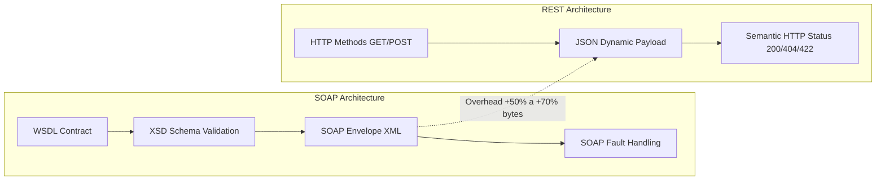

# Border Control: 1999 vs. 2026 (Workstation Edition)

Aplicação web acadêmica e gamificada no estilo *Papers, Please*, desenvolvida para integrar, instrumentar e comparar em tempo de execução real uma **API REST pública (JSON)** e um **Web Service SOAP público (XML baseado em WSDL)** em uma arquitetura de sistemas distribuídos.

---

## 1. Documentações Oficiais e Contratos WSDL

| Serviço / Protocolo | Papel na Aplicação | Documentação Oficial | Endpoint de Produção / WSDL | Backup Local no Repositório |
| :--- | :--- | :--- | :--- | :--- |
| **CountryInfoService (SOAP 1.1 / XML)** | **Mainframe Governamental (1999):** Fonte canônica e imutável de dados internacionais (Capital, Moeda, Código DDI, Continente). | [Oorsprong CountryInfo Docs](http://webservices.oorsprong.org/websamples.countryinfo/CountryInfoService.wso) | [CountryInfoService.wso?WSDL](http://webservices.oorsprong.org/websamples.countryinfo/CountryInfoService.wso?WSDL) | [`contracts/CountryInfoService.wsdl`](./contracts/CountryInfoService.wsdl) |
| **Countries API (Cloudflare / REST JSON)** | **Terminal do Viajante (2026):** Dados dinâmicos de países, capitais, bandeiras e códigos de discagem. | [Cloudflare Countries API](https://countries-api.davegarvey.workers.dev/countries) | `https://countries-api.davegarvey.workers.dev/countries/{code}` | N/A (JSON Schema Dinâmico) |
| **Interpol Biometric Watchlist (REST JSON)** | **Registro de Segurança (2026):** Consulta em tempo real de mandados internacionais e status criminal. | Módulo Nativo REST | `/api/inspections/{id}/interpol-query` | N/A (REST JSON Endpoint) |

---

## 2. Metáfora de Domínio e Mecânica da Cabine (Estilo *Papers, Please*)

O jogador atua como um oficial de alfândega em uma cabine de fronteira internacional. A cada rodada, um viajante se apresenta ao balcão e múltiplas fontes de informação devem ser confrontadas manualmente:

1. **Depoimento Verbal (Balão de Fala):** O viajante fala espontaneamente ao chegar (ex: *"Bom dia oficial. Estou vindo de Tóquio visitar minha irmã com 3000 ienes."*). Contradições entre a fala e o passaporte indicam fraude.
2. **Passaporte Físico na Mesa de Inspeção:** Livreto com textura tátil contendo foto 3x4, nome completo, data de nascimento/idade, data de emissão, data de validade (documentos expirados devem ser barrados!), código ISO e número de documento.
3. **Computador de Bordo (Workstation OS 1999):**
   * **`MAINFRAME.EXE` (Cliente SOAP 1.1 WSDL):** Terminal CRT em fósforo verde com prompt manual. O jogador lê o código ISO no passaporte e **digita manualmente** o comando (ex: `QUERY JP` ou `JP`). O sistema transmite o envelope SOAP XML, mantém histórico rolável de transações e exibe os dados oficiais do WSDL.
   * **`WATCHLIST.EXE` (Cliente REST JSON):** Aplicativo estilo Windows 98 para escanear o passaporte na base da Interpol via endpoint REST, alertando sobre mandados internacionais de prisão (*Red Notice*).
   * **`RULES.TXT`:** Manual de diretrizes operacionais do posto alfandegário.
4. **Carimbos de Mesa Interativos:** O jogador clica fisicamente no carimbo **`[APPROVE PASS]`** (verde) ou **`[DENY ENTRY]`** (vermelho), estampando diretamente sobre o passaporte com efeito sonoro percussivo via Web Audio API.

---

## 3. Evidências Reais de Payloads Brutos Capturados

### 3.1. SOAP: Envelope XML Enviado (Request)
* **Protocolo:** SOAP 1.1 over HTTP/1.1 (POST)
* **Endpoint:** `http://webservices.oorsprong.org/websamples.countryinfo/CountryInfoService.wso`
* **Operação:** `FullCountryInfo`
* **Tamanho do Payload:** 288 bytes

```xml
<?xml version="1.0" encoding="utf-8"?>
<soap:Envelope xmlns:soap="http://schemas.xmlsoap.org/soap/envelope/">
  <soap:Body>
    <FullCountryInfo xmlns="http://www.oorsprong.org/websamples.countryinfo">
      <sCountryISOCode>JP</sCountryISOCode>
    </FullCountryInfo>
  </soap:Body>
</soap:Envelope>
```

### 3.2. SOAP: Envelope XML Recebido (Response)
* **Status HTTP:** `200 OK`
* **Content-Type:** `text/xml; charset=utf-8`
* **Tamanho do Payload:** 762 bytes

```xml
<?xml version="1.0" encoding="utf-8"?>
<soap:Envelope xmlns:soap="http://schemas.xmlsoap.org/soap/envelope/">
  <soap:Body>
    <m:FullCountryInfoResponse xmlns:m="http://www.oorsprong.org/websamples.countryinfo">
      <m:FullCountryInfoResult>
        <m:sISOCode>JP</m:sISOCode>
        <m:sName>Japan</m:sName>
        <m:sCapitalCity>Tokyo</m:sCapitalCity>
        <m:sPhoneCode>81</m:sPhoneCode>
        <m:sContinentCode>AS</m:sContinentCode>
        <m:sCurrencyISOCode>JPY</m:sCurrencyISOCode>
        <m:sCountryFlag>http://www.oorsprong.org/WebSamples.CountryInfo/Flags/Japan.jpg</m:sCountryFlag>
        <m:Languages>
          <m:tLanguage>
            <m:sISOCode>jpn</m:sISOCode>
            <m:sName>Japanese</m:sName>
          </m:tLanguage>
        </m:Languages>
      </m:FullCountryInfoResult>
    </m:FullCountryInfoResponse>
  </soap:Body>
</soap:Envelope>
```

### 3.3. REST: Documento JSON Recebido (Response)
* **Protocolo:** HTTP/1.1 / HTTP/2 (GET)
* **Endpoint:** `https://countries-api.davegarvey.workers.dev/countries/JP`
* **Status HTTP:** `200 OK`
* **Content-Type:** `application/json; charset=utf-8`
* **Tamanho do Payload:** 248 bytes

```json
{
  "name": "Japan",
  "code": "JP",
  "alpha3Code": "JPN",
  "capital": "Tokyo",
  "region": "Asia",
  "subregion": "Eastern Asia",
  "population": 126476461,
  "languages": [
    "Japanese"
  ],
  "currency": "JPY",
  "flag": "🇯🇵",
  "callingCode": "+81"
}
```

---

## 4. Análise Técnica Comparativa: REST vs. SOAP



### 4.1. Overhead de Serialização e Tamanho de Payload
* **SOAP:** Exige a presença de `<soap:Envelope>`, `<soap:Body>`, declaração de namespaces (`xmlns:soap`, `xmlns:m`) e tags verbosas de abertura e fechamento para cada elemento textual (`<m:sCapitalCity>Tokyo</m:sCapitalCity>`). O payload de resposta totalizou **762 bytes**.
* **REST:** Utiliza sintaxe concisa baseada em pares chave-valor `{}` e arrays `[]`. O documento JSON correspondente totalizou **248 bytes**.
* **Resultado Mensurado:** O protocolo SOAP gerou um **overhead de +207% em bytes transmitidos** em comparação direta com o REST.

### 4.2. Tipagem e Contrato: WSDL/XSD vs. JSON Dinâmico
* **SOAP (WSDL / XSD):** O contrato formal `CountryInfoService.wsdl` define estritamente os tipos de dados via XML Schema (`xs:string`, `xs:complexType`). Ferramentas como o `Zeep` compilam os tipos e validam a estrutura da mensagem antes do envio, garantindo integridade estrita. Códigos inexistentes como `ZZ` disparam falha na resolução do schema.
* **REST (JSON):** Tipagem dinâmica nativa. A flexibilidade permite rápida iteração, mas exige validação em camada de aplicação (Pydantic).

### 4.3. Tratamento de Erros: `SOAP Fault` vs. Códigos HTTP Semânticos
* **SOAP:** Erros de schema ou negócio retornam `<soap:Fault>` com `<faultcode>`, `<faultstring>` e `<detail>`, muitas vezes envelopados em HTTP 400 ou 500.
* **REST:** Utiliza a semântica nativa da RFC do protocolo HTTP (`404 Not Found`, `422 Unprocessable Content`). O cliente consegue reagir imediatamente inspecionando o status header.

---

## 5. Arquitetura de Software e Design Patterns

```text
webservices-rest-soap-integracao/
├── app/
│   ├── main.py                     # Inicialização do FastAPI, CORS e montagem estática
│   ├── domain/
│   │   └── models.py               # Entidades de domínio (CountryRecord, ProtocolTelemetry, Passport)
│   ├── adapters/
│   │   ├── rest_adapter.py         # Adapter Pattern: HTTPX assíncrono com telemetria
│   │   └── soap_adapter.py         # Adapter Pattern: Zeep + HistoryPlugin para captura XML
│   ├── game/
│   │   ├── strategies.py           # Strategy Pattern: Injeção de fraudes e anomalias
│   │   ├── repository.py           # Repository Pattern: Sessões de inspeção em memória
│   │   └── service.py              # Motor do jogo, diálogos e validação de vereditos
│   └── api/
│       └── routes.py               # Endpoints REST expostos ao frontend
├── contracts/
│   └── CountryInfoService.wsdl     # Cópia local de backup do contrato oficial WSDL
├── static/
│   └── index.html                  # Workstation SPA em Alpine.js + Tailwind CSS + Web Audio API
├── tests/
│   ├── test_wsdl_contract.py       # Teste de conformidade do WSDL
│   ├── test_adapters.py            # Teste dos adaptadores REST e SOAP
│   ├── test_game_engine.py         # Teste do motor de jogo e estratégias
│   └── test_api_endpoints.py       # Teste de integração dos endpoints FastAPI
├── requirements.txt                # Dependências declaradas
└── README.md                       # Relatório técnico e documentação
```

---

## 6. Instruções de Execução Local

```bash
cd /home/sld2/projects/webservices-rest-soap-integracao
source .venv/bin/activate
pip install -r requirements.txt
pytest
uvicorn app.main:app --reload --port 8000
```
Abra o navegador em: [http://localhost:8000](http://localhost:8000).
